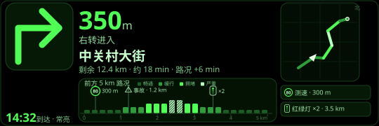

# 高德语音导航 · 语音选点与眼镜原生 HUD

iOS 插件（FOCUS-04 集成版）的高德语音导航：手机侧语音说出目的地，完成选点、算路并把原生导航页投到眼镜 HUD。本文按「语音链路 → HUD 路况扩展 → 固件要求 → 验收边界」组织，配套效果图为设计稿 SVG，真机截图以实际构建为准。

> 和项目其余部分一样：**需要自己的高德 iOS Key**（绑定你实际使用的 Bundle ID，在 App 内 TurboIO → 资料 → 导航 → 高德Key设置 填入），不附带任何作者 Key。地图/导航数据来自高德官方 SDK，本项目不做二次分发。

## 功能总览

| 能力 | 状态 | 说明 |
| --- | --- | --- |
| 语音选点导航（步行/骑行/驾车） | 真机验收 | 「导航去X」触发 → 周边搜索 → 流式候选 → 语音选择 → 算路 → 上镜 |
| 出行方式语音切换 | 真机验收 | 候选确认后追问方式，15 秒默认步行；说"骑车/开车"即切换 |
| 眼镜原生 HUD（TNV1） | 真机验收 | 箭头/距离/时间/小地图/总里程，断连仍有 60 秒超时保护 |
| HUD 路况扩展（lights_m） | 真机验收 | 路况柱状图 + 测速环/事件三角/红绿灯架三类标记 + 红绿灯真距离 |
| 全天智记共存（TLC1） | 真机验收 | 开着智记直接进导航，不再要求先退出全部眼镜任务 |
| 驾车/步行/骑行模拟导航 | 真机验收 | 无 GPS 环境演示全链路；字幕通道仍可用作兼容显示 |

## 语音链路

1. **触发**：对眼镜说「导航去<地点>」（带唤醒词亦可，如"小雷小雷导航去万达"）。触发词用包含匹配——"帮我导航去""请导航去"同样命中。
2. **搜索**：手机后台完成 定位 → 周边搜索（优先 50 公里内，本地无结果降级全国）→ 候选流式上镜。地点带位置上下文，避免同名异地排前；尾部的出行方式词会被剥掉（"金九公寓步行"→ 搜"金九公寓"，"步行街"不受影响）。
3. **选择**：说「第一个 / 第 2 个 / 最近」选择候选，「都不对」重新搜索；15 秒无输入自动取消。选定后追问出行方式。
4. **算路与上镜**：算路以已获取的定位为**显式起点**提交（后台/锁屏安全，不依赖引擎内部定位），成功后 1.2 秒自动开始导航并向眼镜发送 TNV1 页面。锁屏桥接已申请后台时间，息屏可继续上镜。
5. **退出**：说「退下吧」或手机侧结束导航；到达目的地后 10 秒自动收尾并留痕（"已到达目的地：导航自动结束"）。

诊断入口：诊断 → 运行状态 → 适配与回调，语音导航全程面包屑可查（定位/搜索/算路/上镜/被拒原因）。

## HUD 路况扩展（TNV1 lights_m）

在 36 字节协议尾部原保留 2 字节上启用 `lights_m`（最近红绿灯沿路距离，65535 = 无）。**无扩展数据时包长与旧编码逐字节一致，老固件兼容。**

- **路况柱状图**：280×40，柱高 {4,7,10,13} 四级 + 刻度线 + 3×5 点阵距离标签（300m / 1.2km / 3.5km），东西侧翻页避让。
- **三类标记**：测速环（限速数字）、交通事件三角、红绿灯架，按沿路距离落在标记带。
- **红绿灯距离是近似真数据**：高德免费 SDK 无灯距字段（付费 `setIsOpenTrafficLight` 才有），取**最近闯红灯摄像头**（`AMapNaviCameraTypeTrafficLight`）的沿路距离——标出的每个灯口位置都是真的，覆盖随摄像头分布；数量仍走官方字段。

## 全天智记共存（TLC1）

原厂 `isBussinessIdle` 把"开着智记"视为忙碌并拒绝进入导航/音乐等扩展应用。固件侧以重定位副本仅略过智记拒绝分支（诊断门保留严格版），实测：**开着全天智记直接开始导航**，智记继续计时。该改动随 TAP1 固件构建树分发（详见 firmware-research 对应说明）。

## 固件要求

| 手机插件 | 眼镜固件 | HUD 路况扩展 | 智记共存 |
| --- | --- | --- | --- |
| FOCUS-04 集成版 | TAP1-TEST-01 / TAP1-2026-10 等 12 项菜单构建 | ✅（lights_m 编解码三树测试通过） | ✅（TLC1） |
| FOCUS-04 集成版 | FOCUS-04（TFP1） | ❌ 旧协议尾，标记不显示 | ❌ |
| 任意版 | 原厂 1.0.4.12 | ❌ | ❌ |

**升级顺序红线：先装新 IPA，后刷新固件。** 旧 dylib 的编码器不写尾部字段，新固件先刷会把未初始化内存当灯距渲染假标记。固件构建与刷机门禁见 [firmware-research](../firmware-research/README.md) 与 [FOCUS-04 说明](../official-addon/focus-edition/README.md)。

## 验收边界

- 真机验收组合：iPhone（adhoc 签名插件）+ RayNeo iO + Strix OS 1.0.4.12 实验固件；模拟导航全链路 + 实车短途实测。
- 实时导航依赖高德 SDK 定位质量；室内无 GPS 属正常。行车时请勿操作手机，导航页保持前台（后台桥接仅覆盖息屏重试，不构成"完全免持"承诺）。
- 红绿灯距离为摄像头近似，不构成付费灯距字段的数据等价；标记密度取决于高德数据分布。
- 本文档描述为研究性功能，非官方升级、不承诺稳定性；风险与许可同项目根 README。
